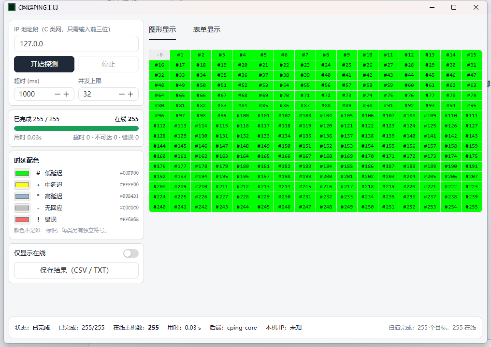
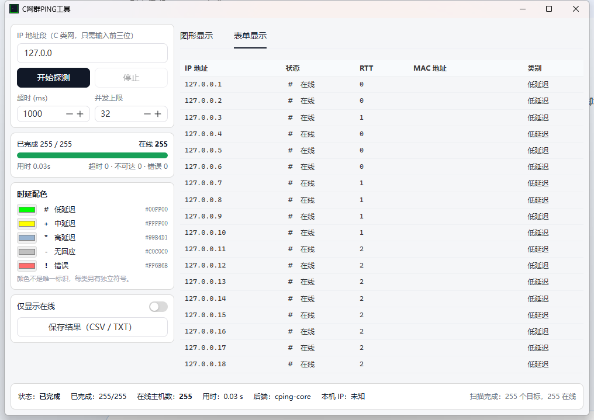
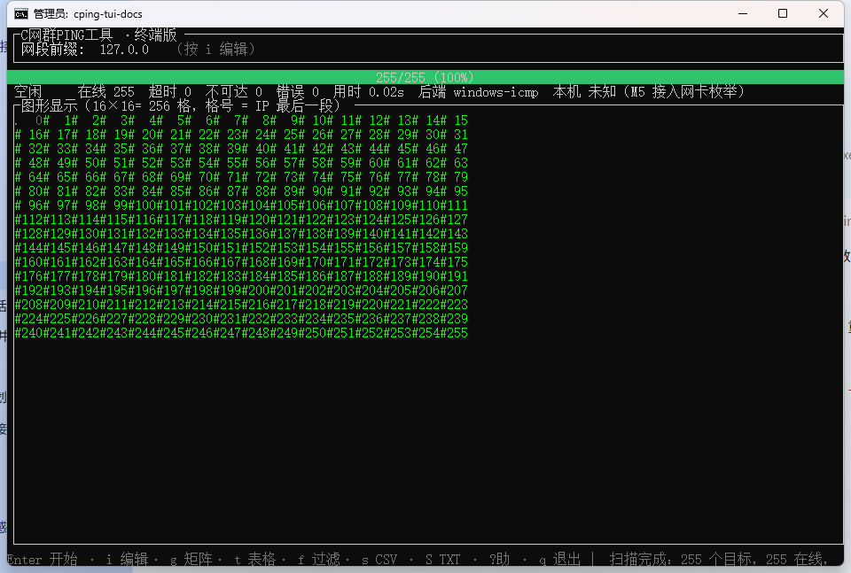
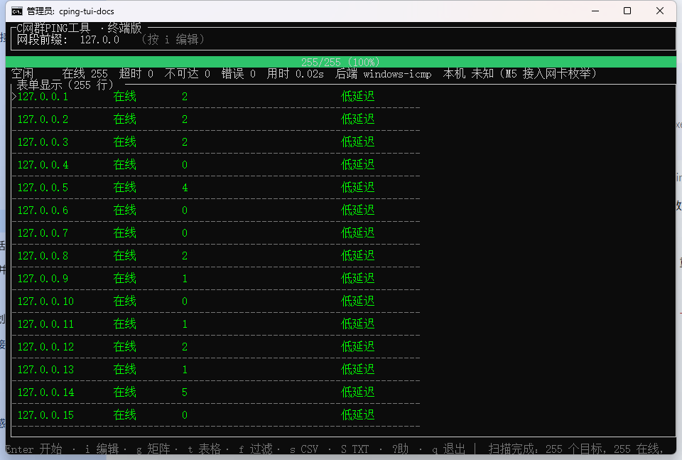
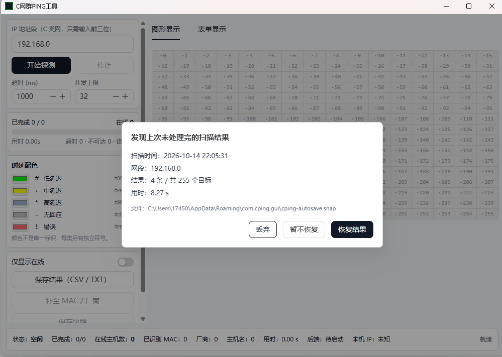
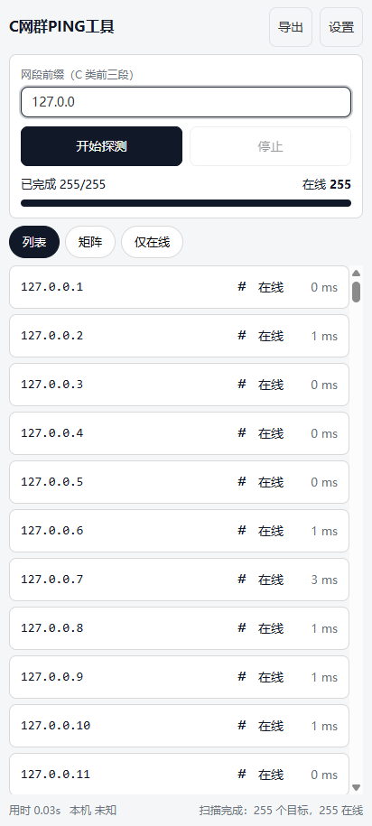
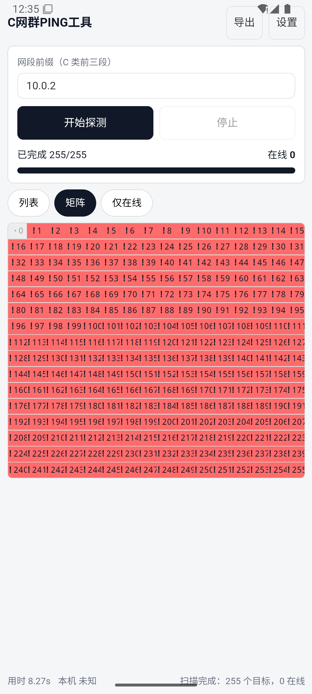
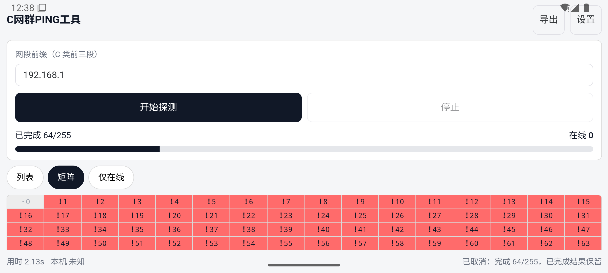

<div align="center">

# CPing

**跨平台局域网批量 PING 工具 —— 一套业务逻辑，三种界面**

Rust 核心 · TUI（ratatui）· 桌面 GUI（Tauri 2 + Vue 3）· Android

[](../../releases)
[](docs/testing.md)
[](LICENSE)
[](docs/platform-compatibility.md)

现代重写版：原软件是 2004 年的 Windows 小工具「C网群PING工具」（Delphi + Synapse）。
本项目先对原版做逆向行为分析（含 Frida 动态复核确证），再按同等交互习惯用现代技术栈重写。

</div>

## 截图

**桌面 GUI（Windows，真实 ICMP 扫描回环网段 127.0.0.x，255/255 在线，用时 0.03s）**

| 矩阵视图 | 表格视图 |
| --- | --- |
|  |  |

**TUI 终端版（同一扫描，`windows-icmp` 后端）**

| TUI 矩阵视图 | 表格视图 |
| --- | --- |
|  |  |

**M7：目标信息与快照恢复**（扫描结果回答「这是谁」，不只是「在不在线」）



**Android 移动布局**（真实 Android 运行时截图）

| 列表视图 | 矩阵视图 | 横屏 |
| --- | --- | --- |
|  |  |  |

> Android 截图摄于 Android 15 模拟器（WHPX 硬件加速）中运行的 APK 本体——
> 与发布产物同一份 Rust 核心 + 前端，非浏览器仿真。截图中全部目标显示
> 「权限不足」是**正确行为**：Android 普通应用无 `CAP_NET_RAW`，无法创建
> raw ICMP 套接字，本工具如实分类而不假装离线（真机上同理，局域网扫描
> 请用桌面端，或在 Android 上改用后续版本的独立 TCP 模式）。

## 为什么重写

| | 原版（2004） | 本项目 |
| --- | --- | --- |
| 技术 | Delphi + Synapse，ASPack 加壳 | Rust + Tauri 2 / ratatui，无壳无混淆 |
| 平台 | 仅 Windows | Windows / Linux / Android |
| 探测 | WinSock ICMP | 平台原生 ICMP 后端抽象（可插拔） |
| 界面 | 单一固定布局 | 桌面矩阵/表格 + 移动列表优先布局 |
| 核心逻辑 | 界面与逻辑耦合 | `cping-core` 独立 crate，三端共用 |

原版确证行为（目标范围 `.1`–`.255`、矩阵行列映射、四档时延配色与符号等）见
[`docs/reverse-findings.md`](docs/reverse-findings.md)。

## 架构

```
cping/
├── crates/cping-core/        共享核心（零第三方运行时依赖）
│   ├── target/result/classify/export   目标生成 · 结果模型 · 分类 · 导出
│   ├── probe/scheduler                 ProbeBackend 抽象 + std 线程并发调度
│   ├── oui/neighbor/hostname/enrich    M7：厂商识别 · ARP 取 MAC · 反查主机名 · 信息补全
│   ├── snapshot                        结果快照落盘与恢复（严格解析，坏数据宁可报错）
│   ├── data/                           IEEE OUI 三表（54,190 条，编译期嵌入）
│   └── native.rs                       Windows/Linux/Android 原生 ICMP
├── apps/cping-tui/           ratatui + crossterm 交互式终端界面
├── apps/cping-gui/           Tauri 2 + Vue 3 + TypeScript
│   ├── src/                  桌面布局 + 移动布局（自动切换）
│   └── src-tauri/            Tauri 容器（16 个 Command，唯一前后端通道）
├── tools/oui-gen/            IEEE 官方 CSV → 嵌入数据表的确定性生成器
└── tools/android-forensics/  Android 平台行为取证对照程序（不参与构建）
```

**逻辑只有一份**：GUI 经 Tauri Commands、TUI 直接调用，都走同一个 `cping-core`。
目标生成、调度、分类、统计、导出不在任何界面里重复实现。

## 构建与测试

```bash
# 核心 + TUI（秒级）
cargo fmt --all -- --check
cargo clippy --workspace --all-targets -- -D warnings
cargo test --workspace
cargo run -p cping-tui

# 桌面 GUI
cd apps/cping-gui
npm install
npm run typecheck && npm run build
cd src-tauri && cargo build --release

# Android（arm64-v8a）
cd apps/cping-gui && npm run tauri:android:build
```

> 常见构建坑（cargo 离线沙箱、npm postinstall、Android 符号校验等）的排查表
> 见 [README 附表](#构建环境注意事项) 与 [`docs/testing.md`](docs/testing.md)。

## 使用

### TUI

```bash
cping-tui                # 交互式启动
cping-tui --prefix 192.168.1
```

| 键 | 功能 | 键 | 功能 |
| --- | --- | --- | --- |
| `Enter` | 开始探测 | `g` / `t` | 矩阵 / 表格视图 |
| `i` | 编辑网段前缀 | `f` | 过滤不在线目标 |
| `Esc` | 取消 / 关闭帮助 | `s` / `S` | 导出 CSV / TXT |
| `m` | 补全 MAC / 厂商 | `n` | 反查当前行主机名 |
| `w` | 保存快照 | `l` | 从快照恢复 |
| `?` / `F1` | 帮助 | `q` / `Ctrl+C` | 退出并恢复终端 |

状态符号：`#` 低延迟 · `+` 中延迟 · `*` 高延迟 · `-` 无回应 · `!` 错误 · `.` 未探测。
**颜色不是唯一标识**：无颜色终端下符号仍然可区分。

可选 `--snapshot-dir <目录>` 指定快照目录（默认当前目录）。

### 桌面 GUI

输入 C 类网段前三段 → 开始探测；矩阵/表格切换、仅在线过滤、时延配色自定义、
保存结果为 CSV（UTF-8 BOM，Excel 直接打开不乱码）或 TXT。

**目标信息（M7）**：扫描结束自动读本机邻居表（ARP）回填 MAC，并按 IEEE 注册数据
（54,190 条，离线内置）显示厂商；表格里每行可按需反查主机名（阻塞操作所以只在
点击时对单行发起）。查不到就留空——不猜、不填占位文本。

**结果快照**：每轮扫描结束自动落盘一份快照；下次启动若发现它会先问是否恢复，
**默认不恢复**（丢弃 / 暂不恢复 / 恢复结果三个出口）。存在的理由是 Android 上
进程会被系统随时回收（销毁 Activity 即退出进程），内存里的结果不可靠。

### Android

列表优先的触控布局：网段输入（数字键盘）→ 开始探测；列表/矩阵页签、仅在线开关、
导出到应用专属外部目录（回报完整路径，Android 10+ 分区存储无需权限）、抽屉式设置。
已在 Android 15 模拟器完成真机级验收：安装/启动/扫描/导出/横竖屏/前后台全部通过；
普通权限下 raw ICMP 被拒（`EPERM`/`EACCES`），状态如实显示「权限不足」，
独立 TCP 连通性模式见路线图 M9。

## 路线图

| 版本 | 阶段 | 主题 |
| --- | --- | --- |
| **v1.0.0** ✅ | M0–M6 | 核心库 · TUI · 桌面 GUI · Android 构建链 · 真实 ICMP（Windows 实测） |
| **v1.1.0** ✅ | M7 | 目标信息增强：OUI 厂商识别（54,190 条离线库）、ARP/MAC、主机名反查、结果快照与恢复 |
| v1.2.0 | M8 | 持续监控：定时重扫、上下线事件流、变化高亮 |
| v1.3.0 | M9 | 探测扩展：自定义端口 TCP 探测、多网段、CIDR |
| v1.4.0 | M10 | 数据与集成：JSON/HTML 导出、扫描对比 diff、无头 CLI |
| v1.5.0 | M11 | 平台与分发：Linux 实测与打包、GitHub Actions CI/CD |
| v2.0.0 | M12 | 架构升级：IPv6、可选 Tokio 异步调度、后端插件化 |

各阶段详细功能与验收条件见 [`docs/plan.md`](docs/plan.md)「路线图」章节。

## 文档

| 文档 | 内容 |
| --- | --- |
| [`docs/reverse-findings.md`](docs/reverse-findings.md) | 原版逆向结论（静态 + Frida 动态复核），确证行为 / 待验证 / 设计决策三清单 |
| [`docs/plan.md`](docs/plan.md) | 分阶段计划、各阶段验收条件、路线图 |
| [`docs/platform-compatibility.md`](docs/platform-compatibility.md) | 各平台 ICMP 能力、权限要求与实测记录 |
| [`docs/testing.md`](docs/testing.md) | 每阶段真实构建/测试记录与踩坑 |
| [`docs/release.md`](docs/release.md) | 产物清单与发布说明 |
| [`CHANGELOG.md`](CHANGELOG.md) | 版本变更记录 |

## 构建环境注意事项

| 现象 | 原因 | 处理 |
| --- | --- | --- |
| `cargo build` 无输出后被 SIGTERM | 沙箱内 registry 探测挂起 | `.cargo/config.toml` 已设 `[net] offline = true`；加依赖时 `CARGO_NET_OFFLINE=false cargo fetch` |
| `npm install` 报 `spawnSync EBUSY` | esbuild/tauri-cli postinstall 无法 spawn | 加 `--ignore-scripts`（平台二进制仍在） |
| npm 装得极慢 | 默认源慢 | `--registry=https://registry.npmmirror.com` |
| GUI 启动显示「localhost 拒绝连接」 | debug 构建找 `devUrl` | 用 `cargo build --release`（资源已内嵌） |
| `schemars` 编译失败（`E0107`） | `indexmap 1.x` 的 `std` feature 默认关 | 在 `[dependencies]` 与 `[build-dependencies]` **两处**声明 `indexmap/std` |
| Android：`.so` 校验报 missing runtime symbols | `run()` 缺移动端入口宏 | 补 `#[cfg_attr(mobile, tauri::mobile_entry_point)]` |
| Android：Kotlin 报 different roots | tauri-plugin 源码与工程跨盘符 | `gradle.properties` 设 `kotlin.incremental=false` |
| Android：compileSdk 37 找不到 | 本机只装到 android-36 | `app/build.gradle.kts` 用 36 |
| `sdkmanager` 下载极慢（单连接 ~0.3 MB/s） | 无多线程下载 | 多线程分段拉取 zip 后解包 + 手写 `package.xml`（见 `docs/testing.md`） |
| `avdmanager` 报 *Package path is not valid*（却又把该路径列为合法） | 该版 cmdline-tools 解析系统镜像元数据有 bug | 手写 AVD 的 `config.ini`（emulator 只读它） |

## 已知限制与使用声明

- **Windows 已实测真实 ICMP**（普通权限可用）；Android 已在模拟器实测（raw ICMP
  被拒，如实显示「权限不足」）；Linux 的原生 ICMP **未实测**。拿不到权限时按
  「权限不足」如实上报，绝不把 TCP 连通性伪装成 ICMP 成功。
- **Android 已在 Android 15 模拟器完成真机级验收**（安装/启动/扫描/导出/横竖屏/
  前后台）；真机上的厂商后台管控与字体缩放仍待验证。
- 本机地址与 MAC 尚未接入平台枚举，界面显示「未知」，**不伪造**。
- 目标范围默认 `.1`–`.255`（对齐原版），`.0` 不参与探测。
- **仅用于你拥有或获授权管理的网络**；并发与目标数均有上限。

## License

[MIT](LICENSE)
